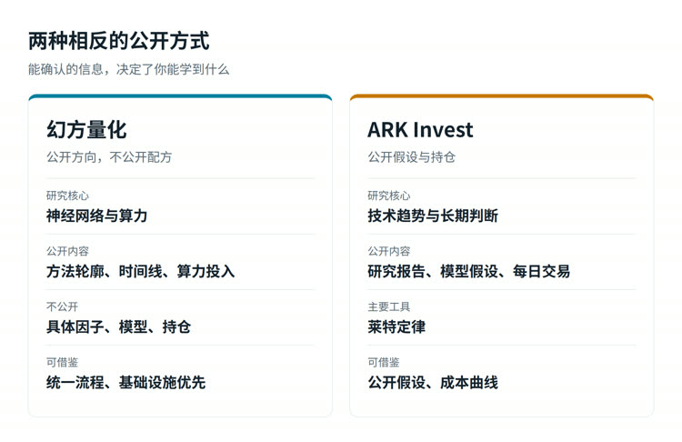
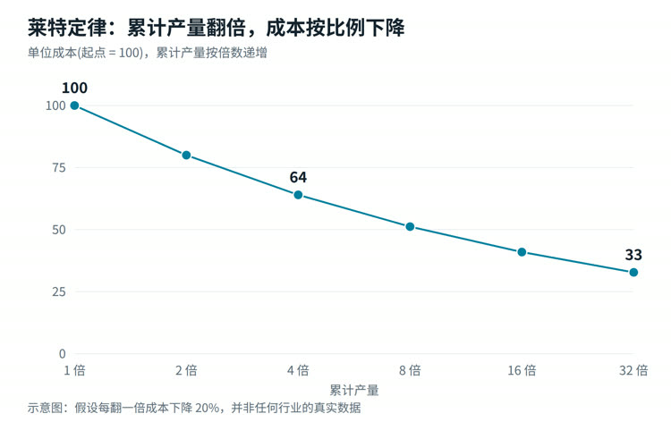

# 从幻方到 ARK：两家风格相反的机构，公开资料里能学到什么

> 2026-11-02 · 历元智能投研 · 约 5 分钟阅读 · 首发于微信公众号「历元智能投研」

> 本文只做公开信息整理与方法论讨论，不评价任何基金或股票的投资价值。文中业绩数据来自公开报道，用于说明风险，不构成任何推荐。

一家几乎不说自己怎么赚钱，一家每天公开自己买卖了什么。

幻方量化和 ARK Invest 是投资圈里风格最相反的两家机构：前者把神经网络和算力放在中心，后者把技术趋势和长期判断放在中心。很多人想从它们身上找到可以照搬的方法，但真正能借鉴的东西，和想象中不太一样。

这篇文章想回答三个问题：两家公开过什么，哪些方法普通研究者能用，哪些看起来很美但学不来。

图 1：两家公开内容的差别，内容据公开资料整理

## 一、幻方：公开的是方向，不是配方

先说结论：**幻方的具体因子、模型和持仓都不公开。** 市面上所谓"幻方策略"的说法，大多无法验证。

能从公开报道里确认的信息大致有三类。

**第一是方法的轮廓。** 公司的公开表述是，融合多周期市场信息和基本面信息，以神经网络为核心训练模型，预测标的价格变化，再优化组合的收益风险比，并在统一架构下叠加多个策略。

**第二是时间线。** 据公开报道，2016 年 10 月，幻方第一个由深度学习模型生成的股票仓位上了实盘；到 2017 年底，几乎所有量化策略都已采用 AI 模型。

**第三是算力投入。** 2020 年投用的"萤火一号"总投资近 2 亿元，搭载 1100 张高端显卡；2021 年交付的"萤火二号"投入约 10 亿元。

> 这些信息不能告诉你幻方怎么选股，但能告诉你它把钱和时间花在哪里。

普通研究者能借鉴的，是三条思路：

- **研究流程要统一。** 不要每做一个想法就另起一套代码和数据。统一的数据口径和回测框架，长期看比任何单个策略都值钱。
- **基础设施先于策略。** 数据有没有时点错误、回测有没有混入未来信息，这些枯燥的工作决定了后面所有结论是否可信。
- **信号和组合是两件事。** 预测得准只是第一步，扣掉成本、控制好风险之后还剩多少，才是结果。

不能照搬的也很明确：算力、逐笔数据、工程团队和高频执行。这些是规模带来的优势，个人复制不了，也不必复制。

## 二、ARK：公开得彻底，但公开不等于正确

ARK 的特别之处是透明。它公开研究报告和模型假设，每天披露持仓和交易，在主动管理机构里很少见。

它最有代表性的工具是**莱特定律（Wright's Law）**：一项技术的累计产量每翻一倍，成本就下降一个相对固定的比例。

和摩尔定律不同，莱特定律描述的是"成本与累计产量"的关系，而不是"成本与时间"的关系。这个区别很重要：**成本下降不是时间自动带来的，而是规模带来的。** 所以它提供了一种推演工具：按历史斜率估算，如果某项技术的出货量继续翻倍，成本可能降到什么范围。这只是基于历史规律的情景推演，不是对未来的预测。

这个框架尤其适合研究 AI 算力、电池、光通信这类规模效应明显的产业。

图 2：莱特定律示意，假设每翻一倍成本下降 20%，非真实数据

除此之外，ARK 还有三个值得学习的习惯：

- **先看趋势，再看公司。** 先判断技术和产业走向，再去找受益环节。
- **公开假设。** 其年度《Big Ideas》报告把推演过程摆出来，读者可以逐条核对，判断错了也有据可查。
- **开放研究。** 把外部专家和公开讨论纳入研究流程，而不是只在内部闭门判断。

## 三、必须同时看到的另一面

如果只讲方法不讲结果，这篇文章就有失公允。

ARK 旗舰产品 ARK Innovation ETF 的波动非常大。第三方回测网站 LazyPortfolioETF 的数据显示，2014 年 10 月至 2026 年 10 月，其最大回撤约 **80.9%**。另据 The Wealth Advisor 报道，晨星分析师 Amy Arnott 2025 年 3 月的分析认为，该产品在 2014 到 2024 年间造成了约 **70 亿美元** 的投资者财富损失。这个口径看的是资金进出后投资者实际的盈亏，不等于产品净值的涨跌；报道认为部分原因是大量资金在高点进入。与此同时，该产品在某些年份涨幅又非常突出。

这说明了一个常被忽略的事实：

> 产品的长期回报，和持有人实际拿到的回报，可能是两回事。

更进一步的教训是：**主题判断正确，不等于价格合理。** 一项技术可以真的改变产业，但如果估值已经隐含了未来数年的较高增长，即便增长兑现，持有回报也未必理想。

幻方这边同样要保持清醒。它的公开信息太少，外界很难独立验证其方法的效果。把一家成功机构的公开标签，理解成成功的原因，是常见的认知偏差。

## 四、对普通研究者最实用的三件事

图 3：不依赖规模的三个研究习惯

把两家放在一起看，可以提炼出几条不依赖规模的做法。

**1. 给长线研究加一张"成本曲线"。** 研究规模效应明显的行业时，把累计产量和单位成本画出来，看它处在曲线的哪一段。比起一句"行业前景广阔"，这种判断更具体，也更容易被验证或推翻。

**2. 写下假设，定期回头打分。** 每次做判断时写清楚：我相信什么，什么数据出现时说明我错了。半年或一年后回来核对。这个习惯不需要任何算力，但能实打实地减少事后自我安慰。

**3. 把"好公司"和"好价格"分开看。** 趋势研究回答的是方向，估值和现金流回答的是代价。两件事都要做，不能用其中一个代替另一个。

## 五、小结

幻方提醒我们，研究是一项系统工程，流程和数据比灵感重要；ARK 提醒我们，长期判断需要公开的假设和可验证的逻辑，同时也用自己的波动告诉大家，方向对了不代表结果就好。

两家都不是用来模仿的模板。更有价值的，是从它们公开的部分学习思考方式，再认清自己的条件：不拼算力和速度，把时间花在假设清楚、证据可查、能够回头检验的研究上。

**资料来源**：ARK Invest 官方投资流程文件与 FAQ；36 氪《隐秘AI巨头"幻方量化"》；搜狐《对话幻方量化陆政哲》；The Wealth Advisor 关于 ARK Innovation ETF 的报道（引述晨星分析）；LazyPortfolioETF 回撤数据。

本文为公开信息整理与数据复盘,**非投资建议、非荐股**,作者无证券投资咨询资质,不构成任何买卖要约,不保证数据准确或投资盈利。市场有风险,决策请自行判断并自担风险。

---

本文为公开数据的历史统计与方法论讨论，不涉及具体股票，不构成投资建议。更多文章见公众号「历元智能投研」。
