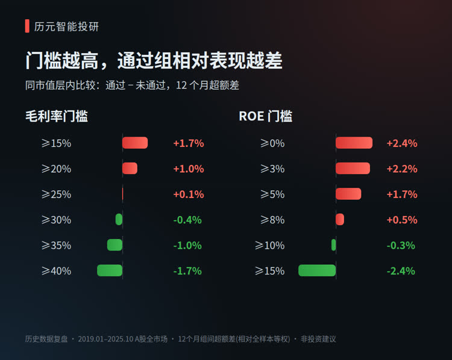
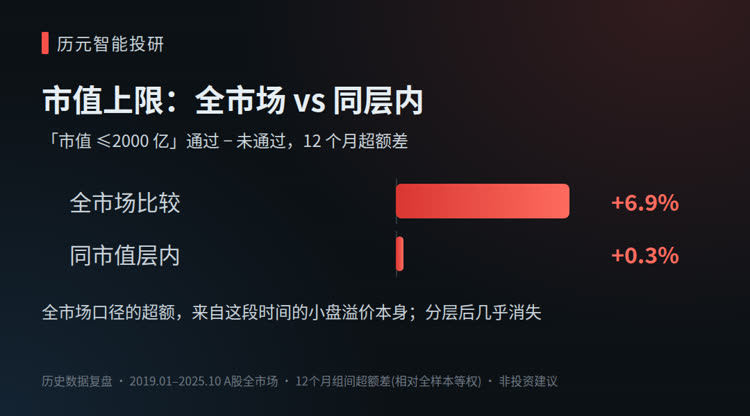
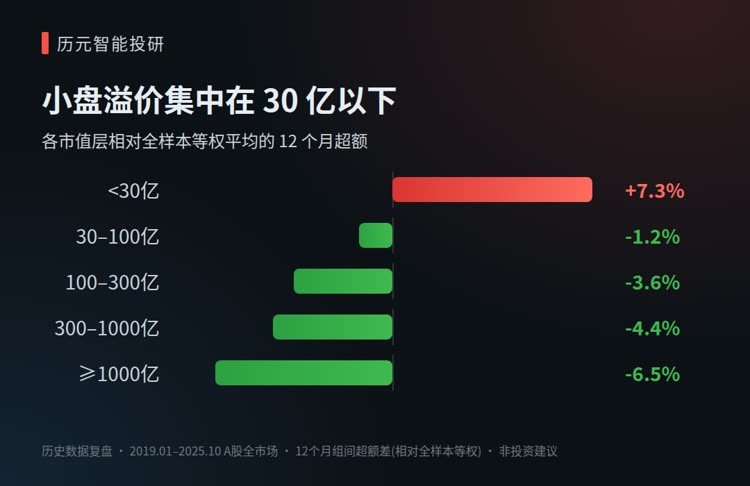

# 高毛利、高 ROE 就是好公司？用 7 年 A 股数据检验 4 条常见选股门槛

> 2026-11-04 · 历元智能投研 · 约 7 分钟阅读 · 首发于微信公众号「历元智能投研」

> 本文是一次公开数据的历史统计复盘，讨论的是选股方法本身，不涉及任何具体股票，不构成投资建议。历史统计不代表未来表现。

很多人做选股，第一步都会先设几道门槛：毛利率要高，ROE 要高，股本不能太大，市值不能太大。

这些门槛听起来都有道理。高毛利说明有定价权，高 ROE 说明赚钱效率高，小股本、小市值弹性大。我们自己的研究系统里，也有一套类似的「六条标准」。

但「听起来有道理」和「在数据里站得住」是两回事。这次我们把其中能用历史数据检验的 4 条，放到 A 股全市场里跑了一遍。结果有几处和直觉相反。

## 一、怎么检验的

**样本：** 2019 年 1 月到 2025 年 10 月，每个月末的 A 股全市场截面，共 82 个月，平均每月约 4,200 只股票。

**数据来源与口径：** 行情与财务数据来自 Tushare。每个月末只使用当时已经公告的财务数据。比如 4 月底时，只能用到已经披露的年报或季报，不能「偷看」之后才公布的数字。这一点很重要，很多回测结论站不住，就是因为用了当时还看不到的数据。

**比较方法：** 每条门槛把股票分成「通过」和「未通过」两组，比较两组在之后 12 个月里，相对同期全样本等权平均的超额收益差。下文的百分比都是这个口径，不同表格之间的数字不能相加。

**一个关键处理：** 我们把股票按市值分成五层（30 亿以下、30–100 亿、100–300 亿、300–1000 亿、1000 亿以上），在每一层内部分别比较。原因后面会讲：如果不这样做，很多结论其实只是「小盘股涨得多」的影子。

检验的 4 条门槛是：毛利率、ROE、总股本、总市值上限。另外两条（主营业务集中度、股东结构）没有可靠的历史时点数据，这次没有检验。

## 二、发现一：单独看，4 条门槛都没有显著的区分力

在全样本口径下剥离市值影响之后，4 条门槛的「通过组 − 未通过组」，12 个月超额收益差都在正负 2 个百分点以内，统计显著性（t 值）都低于 2。需要说明的是，这是把五个市值层合在一起的结果；单看某一个市值层，个别门槛的差异会大得多（见第五节）。

换句话说：**单凭其中任何一条，都不能可靠地把「之后表现更好」的股票挑出来。**

这不等于这些门槛没用。它们更像是一道准入关，把明显不合格的公司挡在外面；至于哪只更好，需要另外的方法来判断。

## 三、发现二：毛利率门槛越高，结果越差

我们把毛利率门槛从 15% 一路调到 40%，看「通过 − 未通过」的差值（同一市值层内比较，持有 12 个月）：

| 毛利率门槛 | 通过 − 未通过 | 通过的股票占比 |
|---|---|---|
| ≥15% | +1.7% | 78% |
| ≥20% | +1.0% | 65% |
| ≥25% | +0.1% | 52% |
| ≥30% | −0.4% | 41% |
| ≥35% | −1.0% | 31% |
| ≥40% | −1.7% | 23% |

门槛越高，通过组的相对表现越差。

一个合理的解释是：**高毛利是市场一眼就能看到的优点，往往已经反映在价格里了。** 你筛出来的是「大家都知道它好」的公司，而不是「还没被充分定价」的公司。

另外，不同行业的毛利率天差地别。软件、医药天然高毛利，制造业天然低毛利。用一条绝对线去卡，等于把很多行业整体挡在门外。更合理的做法是和同行比，看它在所在行业里处于什么位置。

## 四、发现三：ROE 真正有用的，是「不亏钱」那条线

同样的方法扫一遍 ROE 门槛：

| ROE 门槛 | 通过 − 未通过 | 通过的股票占比 |
|---|---|---|
| ≥0% | +2.4% | 83% |
| ≥3% | +2.2% | 68% |
| ≥5% | +1.7% | 56% |
| ≥8% | +0.5% | 40% |
| ≥10% | −0.3% | 30% |
| ≥15% | −2.4% | 14% |

规律和毛利率类似：**门槛放在「是否盈利」附近效果最好，越往上抬越差。** 排除掉亏损公司是有价值的；但去追求特别高的 ROE，效果反而变差，一个可能的原因是高 ROE 公司的估值往往偏高（本文没有直接检验估值，这只是推测）。

图 1：毛利率与 ROE 门槛的阈值扫描（同市值层内，12 个月超额差）

有一个例外值得记下来：在 1000 亿市值以上的大盘股里，ROE ≥5% 这条线的区分效果相对明显（+4.5%，t 值 2.0）。不过这一层平均只有约 120 只股票，t 值也只在临界水平，只能当作描述性的观察，不宜过度解读。

## 五、发现四：「股本不超过 30 亿股」是个有用的意外

这条门槛本来只是想避开「盘子太大」的公司。数据显示，它在 30–100 亿市值这一层里效果很强：通过组比未通过组在 12 个月里高出约 12 个百分点（t 值 3.5，该层平均约 1950 只股票），是这次检验里最显著的结果。

细想一下原因：市值只有 30–100 亿、股本却超过 30 亿股，意味着股价很低，通常在几元钱附近。**这条门槛实际上排除的是「股本巨大、股价很低」的那类股票。** 在 A 股历史上，这类股票整体表现偏弱。

所以它有用，但有用的理由和设计它时想的不一样。

## 六、发现五：市值上限是风格选择，不是超额来源

如果直接在全市场比较，「市值不超过 2000 亿」的通过组，12 个月超额高出 6.9 个百分点，看起来很有效。

但在同一市值层内部比较，差值只剩 0.3 个百分点。

原因是这段时间 A 股的小盘股整体涨得更多。「市值上限」只是把组合往小盘方向推了一把，超额来自小盘溢价本身，而不是这条门槛选出了更好的公司。

这正是我们坚持「分层比较」的原因：**很多看起来有效的选股条件，剥掉市值之后就消失了。**

图 2：市值上限在全市场与同层内比较的差异

## 七、发现六：小盘溢价集中在微盘股，而且很难拿到

按市值分层看，各层相对全市场平均的 12 个月超额是：

| 市值层 | 12 个月超额 | 平均股票数 |
|---|---|---|
| 30 亿以下 | +7.3% | 约 960 只 |
| 30–100 亿 | −1.2% | 约 1950 只 |
| 100–300 亿 | −3.6% | 约 840 只 |
| 300–1000 亿 | −4.4% | 约 310 只 |
| 1000 亿以上 | −6.5% | 约 120 只 |

小盘溢价几乎全部集中在 30 亿以下的微盘股。但这些股票的日成交额往往只有几百万甚至更少，资金稍微大一点就买不进、卖不出。账面上的溢价，实际操作中很难拿到。

图 3：各市值层相对全样本的 12 个月超额

这也提醒我们：**比起市值下限，「每天成交额够不够」是影响研究结论能否实际执行的关键约束。**

## 八、我们因此做了什么调整

基于这次检验，我们对自己研究框架里的筛选参数做了几处调整（仅为个人研究框架的参数修改，不构成任何操作建议）：

1. 毛利率门槛从 30% 降到 20%；没到 20% 的，只要高于所在行业的中位数，也算通过。
2. ROE 门槛从 5% 降到 3%，核心是排除亏损。
3. 股本不超过 30 亿股，保留。
4. 市值上限放宽。它是风格选择，不影响结论。
5. 新增一条流动性门槛：近 20 个交易日日均成交额不足的，即使其他条件全部满足，也不进入重点研究名单。

门槛只负责准入；在通过门槛的公司之间如何比较，需要另外的研究方法。

## 九、这次检验的局限

- **时间段的影响：** 2019–2025 年恰好是 A 股小盘风格占优的时期，换一段时间，部分结论可能会变。
- **只检验了 4 条：** 主营业务集中度和股东结构没有历史数据，无法检验。
- **替代条款未还原：** 「毛利率或 ROE 连续几个季度改善」这类附加条件，没有在历史数据里重建。
- **样本内统计：** 这是描述性的样本内结果，没有做样本外验证，也没有对多次比较做统计校正。
- **统计不等于收益：** 文中的数字是两组股票平均超额收益的差，不是任何策略的实际收益，也没有扣除交易成本。

## 小结

常见的选股门槛不是没用，而是作用和我们以为的不一样。

- 毛利率、ROE 的门槛**不宜设得太高**，「不亏钱」比「赚得特别多」更有区分度。
- 有些门槛的效果来自**意外的原因**，比如股本门槛实际上是在排除低价股。
- 有些门槛的效果**只是市值风格的影子**，分层之后就消失了。
- 真正影响能不能买的，是**流动性**。

做研究最怕的，不是条件设错，而是从来不去检验自己设的条件。

本文为公开数据的历史统计与方法论讨论,**非投资建议、非荐股**,作者无证券投资咨询资质,不构成任何买卖要约,不保证数据准确或投资盈利。市场有风险,决策请自行判断并自担风险。

---

本文为公开数据的历史统计与方法论讨论，不涉及具体股票，不构成投资建议。更多文章见公众号「历元智能投研」。
